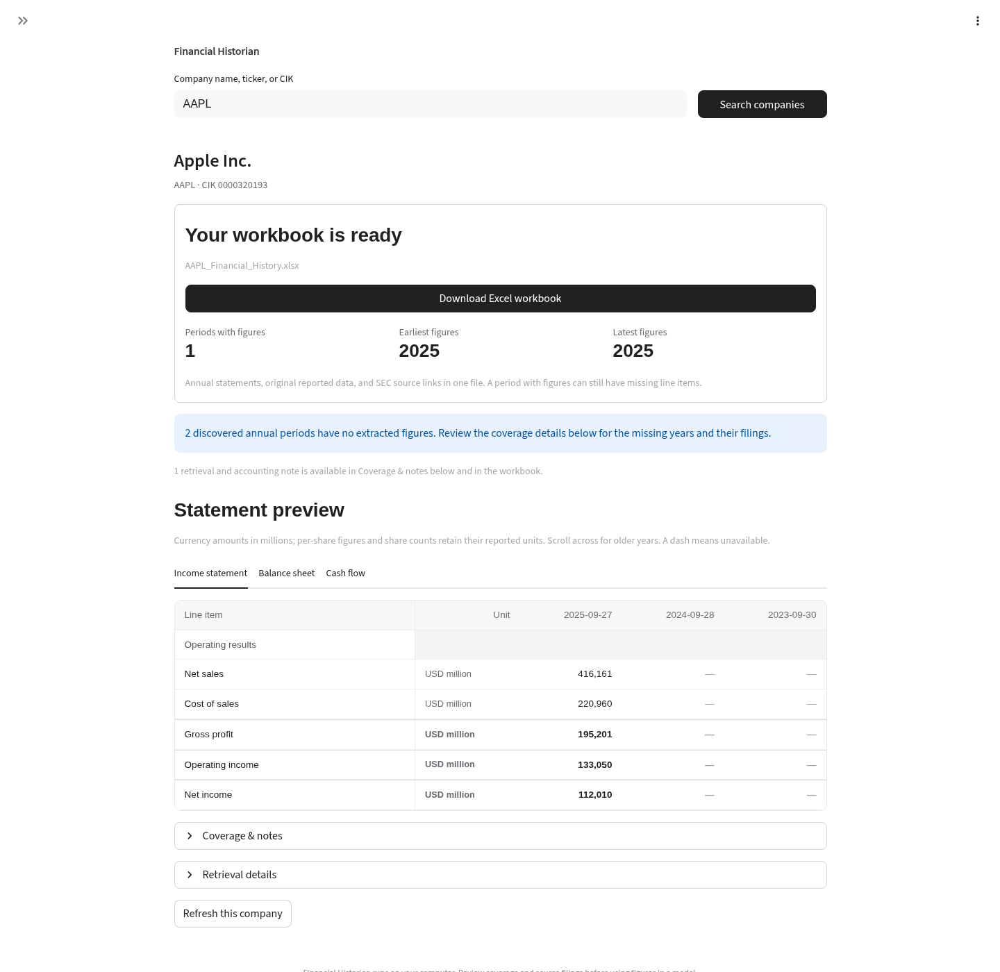

# Financial Historian

A private, local Python application for researching the annual financial history of U.S. public companies. Search by company name, ticker, or SEC CIK, then download an Excel workbook containing available annual statements and their SEC sources.

The browser interface uses a clean, light layout with company search, a company research page, optional Yahoo Finance market context, a single changing progress message, and a prominent Excel download. The app connects to public SEC endpoints and does not require a paid SEC subscription or API key.



*Interface preview using offline demonstration data.*

## Start on Windows 11

1. Use your installed Python, or install it from [python.org](https://www.python.org/downloads/windows/). **Python 3.12 and 3.14.6** passed the application tests on Linux; Windows dependency wheels are available for 3.14. Python 3.11 or later is required. Include the Python launcher or select **Add Python to PATH**.
2. Download or clone this repository and extract it into a folder you can write to.
3. Double-click **launch_windows.cmd**. The first launch creates `.venv` and installs the pinned dependencies; this requires internet access. Subsequent launches reuse the environment unless requirements change.
4. Enter your real name or organization and contact email in the sidebar. The SEC requires an identifying contact in automated requests. These details are saved locally in `data/settings.json`; they are not an account or API key.
5. Search, select a company, optionally refresh market data, choose **Prepare Excel download**, then **Download Excel workbook**.

Keep the launcher window open while using the application. Press **Ctrl+C** in that window to stop it. If the browser does not open automatically, enter `127.0.0.1:8501` in your browser. The server binds to the loopback interface so other machines cannot connect to it by default.

The launcher installs from `requirements.txt` into this project's private environment. It preserves normal TLS and package verification. Do not bypass certificate verification if your network or corporate proxy reports a trust problem.

The launcher uses the default installed Python selected by `py` (or `python` if the launcher is unavailable). It does not require a separate Python 3.12 installation. If an older attempt left an unusable `.venv`, rename that folder to `.venv-old` and launch again. Keep your `data` folder to preserve saved contact settings.

## Historical coverage and financial interpretation

The web application presents the latest **20 fiscal periods** for supported companies. It does not permanently archive the entire supported universe. SEC discovery and raw source records remain auditable during generation, while the statement presentation applies the 20-period window. This does not guarantee a complete company's lifetime or every original statement line item.

Structured company facts are strongest in the XBRL era, generally around 2009 onward. Filing discovery can find earlier annual reports; supported machine-readable statements are inspected where possible. Older plain-text reports, scanned documents, inaccessible filings, and nonstandard layouts may need manual review. Filing coverage records identify what was attempted and what could not be extracted. A historical filing link is not evidence that all its figures were parsed.

For comparable annual periods, the app favors values appearing in the **latest eligible annual filing** among the retrieved records. This is a useful starting point for historical analysis, but a later comparative value does not by itself prove a formal restatement. Filing dates, SEC tags, units, extraction methods, selection notes, and source links make the choice reviewable. The workbook does not automatically normalize one-time items or create forecasts, valuations, or an investment recommendation.

The workbook presents Profit & Loss, Balance Sheet, and a compact Cash Flow summary with a separate Cash Flow Detail sheet. Verified equivalent financial concepts share a continuous historical row, while each cell retains its original tag and filing. Distinct scopes, including current/noncurrent balances and continuing/total operations, remain separate. Empty years at the edges of a statement are listed in coverage rather than displayed as empty columns; missing years within the retrieved span stay visible. Statement sheets display currency amounts in millions, with units clearly labeled, and preserve the printed statement sign where it is extractable. The Data Sheet keeps the underlying reported XBRL values, which can use a positive conceptual value for an outflow printed as negative. Per-share values, share counts, and other units are not scaled as currency. Missing values remain missing, rather than becoming zero. Company-specific tags are retained where extractable; older or unusual filings, foreign issuers, financial institutions, and changed taxonomies can limit comparability. Reported EPS and share counts are not uniformly adjusted for stock splits across the full history. Review source filings, stock splits, and coverage notes before using the export in a financial model. Core-row checks and available balance/cash reconciliations identify some extraction problems; passing them does not establish a complete or audited statement.

## Local files and privacy

The following folders are ignored by Git:

- `data/`: your local SEC contact settings and cached public SEC responses.
- `logs/`: rotating operational logs.
- `exports/`: an optional location for workbooks you save yourself.
- `.venv/`: installed Python dependencies.

Your configured contact is sent to the SEC in the HTTP user-agent header, as required by its access policy. The app makes requests for the company you select; it does not run a background archive or crawl every company. The diagnostic download contains sanitized session events and omits contact details. Do not publish your local settings file. Keep a local backup if you want to preserve settings when moving the app.

You can provide an existing contact with the `SEC_USER_AGENT` environment variable instead of entering it in the first-launch dialog. Supply a real identifying name and email; do not use invented contact details. The dialog keeps the entered contact in the current browser session by default and does not write it to project files.

## Market data

The optional market panel uses Yahoo Finance through `yfinance` for historical daily prices and the latest available quote. Yahoo data is not guaranteed real-time. The interface labels the quote as “latest available close” or unavailable, shows its retrieval timestamp and timezone, and does not block SEC financial-statement retrieval when market data fails. Market requests use a bounded in-memory cache and are kept separate from SEC filing data. Company-universe suggestions are loaded on demand from the documented public S&P 500 and Nasdaq-100 directory pages and include the membership retrieval timestamp.

## Development

Use the existing checkout. A separate Git worktree is unnecessary for the normal workflow.

```bash
python3 -m venv .venv
source .venv/bin/activate
python -m pip install -r requirements-dev.txt
python -m pytest
python -m streamlit run app.py --server.address=127.0.0.1 --server.port=8501
```

On Windows, activate the environment with `.venv\Scripts\activate` instead. The Windows launcher installs only runtime dependencies; install `requirements-dev.txt` explicitly when you want to run the tests.

Network access to `www.sec.gov` and `data.sec.gov` is needed for SEC retrieval. Dependency installation uses PyPI and its package distribution hosts. SEC access may be refused on some hosted or corporate networks even with a valid identifying user-agent. In that case, retry from the local Windows installation and preserve secure certificate verification. Offline tests validate extraction and workbook behavior; they cannot prove live SEC accessibility from your network.

If retrieval fails, use **Help & diagnostics → Download diagnostic log** in the sidebar. Check the SEC contact, internet access, and reported coverage before retrying. Refreshing reloads filing indexes and structured facts from the SEC; previously filed primary documents can be reused from the local cache.
